<div align="center">




**Download your Chess.com games, step through each move, and see where the game turned.**

</div>

## What it does

- **Imports your games** from the Chess.com public API (your most recent monthly archives).
- **Analyzes every position with Stockfish** over UCI at depth 15. The analysis runs on a background thread, so the window keeps responding while it works.
- **Labels each move** as Excellent, Good, Inaccuracy, Mistake or Blunder, based on how many centipawns the move lost compared with the engine's best.
- **Shows an evaluation bar** and the engine's suggested continuation for each position.
- **Optional coaching notes** (`coach.py`) that turn engine output into plain-English explanations using the Google Gemini API.

## How it works

```
Chess.com API ──► game list ──► open a game
                                   │
                  UI thread (Pygame, 60 FPS cap)        background thread
                  draws board, eval bar, sidebar  ◄──   Stockfish: one analysis per position
                  shows progress, then review mode      stores score + best line, then sets done
```

1. **Pygame owns the window.** The main loop caps the frame rate at 60 and handles clicks and drawing.
2. **Opening a game starts a worker thread.** `GameAnalysis.analyze` walks the game, asks Stockfish for a score and best line at every position, and records progress as it goes.
3. **The UI polls for completion.** When the thread marks the analysis done, the app switches from loading to review mode.
4. **Move quality comes from the swing.** The loss in centipawns between the engine's best move and the one played is mapped to a label:

| Centipawn loss | Label |
|---|---|
| up to 15 | Excellent |
| up to 40 | Good |
| up to 90 | Inaccuracy |
| up to 200 | Mistake |
| more than 200 | Blunder |

## Project layout

| File | Purpose |
|---|---|
| `main.py` | Pygame app: game list, board, eval bar, threaded Stockfish analysis |
| `fetch_games.py` | Chess.com archive download |
| `engine_eval.py` | Batch Stockfish evaluation of a stored game |
| `coach.py` | Gemini-generated coaching text |
| `database.py` | Syncs your Chess.com archive into a local SQLite database |
| `parse_sgn.py` | PGN parsing and board-history walk-through |
| `analyze_game.py` | Per-move clock-time analysis from PGN `%clk` comments |
| `test_api.py` | Quick Chess.com API connectivity check |

## Run it

```bash
brew install stockfish            # or install Stockfish and update STOCKFISH_PATH in main.py
python3 -m venv .venv && source .venv/bin/activate
pip install -r requirements.txt
python main.py
```

Set `CHESS_COM_USERNAME` in `main.py` to your Chess.com username. For coaching notes, put `GEMINI_API_KEY=...` in a `.env` file, which is already in `.gitignore`.

## What I'd improve next

I'd rather list the gaps than hide them.

- **No result cache.** Reopening a game runs Stockfish on it again. Saving analysis in the SQLite database would make repeat opens instant.
- **No performance measurements yet.** The 60 FPS figure is a frame cap, not a measured rate, and I haven't timed the analysis. I'd add a small script that measures both before quoting any number.
- **No automated tests.** `test_api.py` only checks connectivity. The move-quality thresholds are the first thing I'd cover.
- **Two analysis depths.** The app uses depth 15 and the batch script uses depth 12. They should share one setting.

## Credits

Built with [python-chess](https://python-chess.readthedocs.io/), [pygame-ce](https://pyga.me/) and [Stockfish](https://stockfishchess.org/). Game data comes from the [Chess.com public API](https://www.chess.com/news/view/published-data-api). Piece images are fetched on first run from a third-party chess-pieces set and remain their authors' property. This project isn't affiliated with Chess.com or the Stockfish team.
