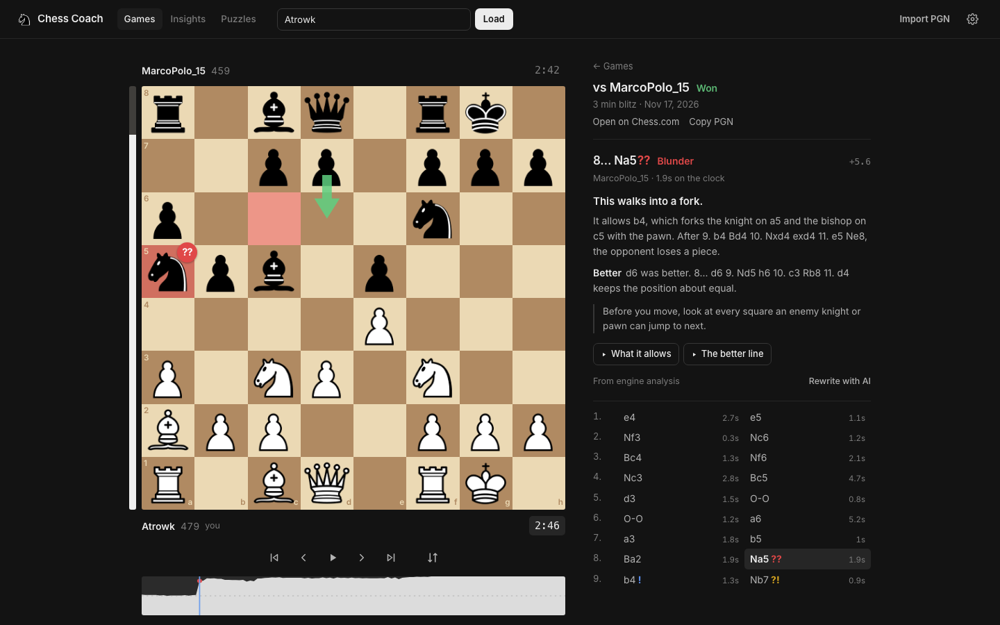
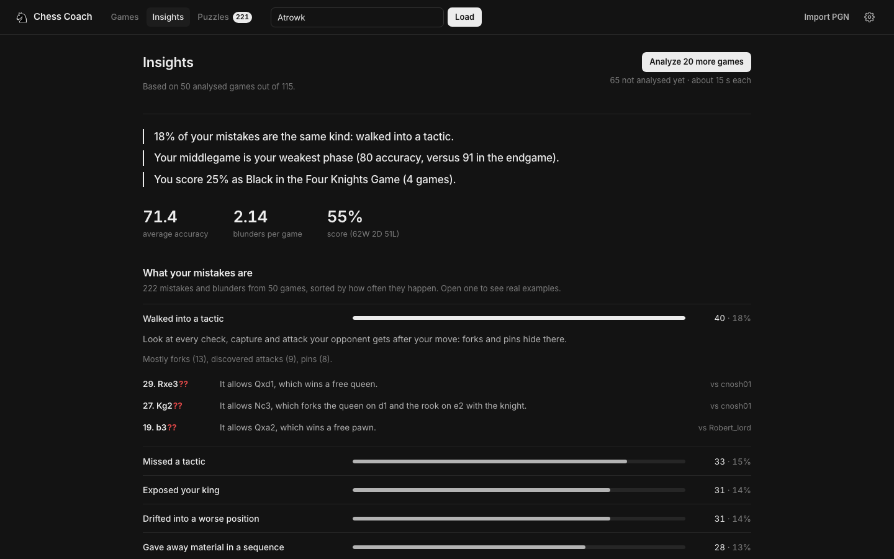
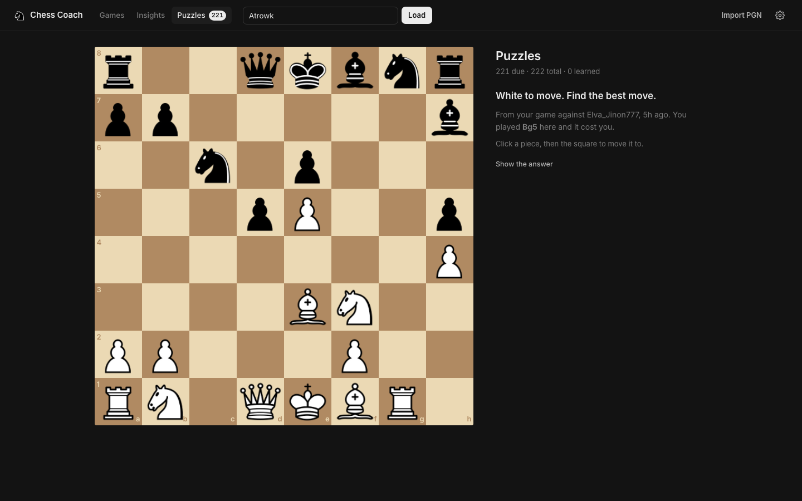

<div align="center">


[](https://github.com/atharv-pandey-08/Chess-Coach/actions/workflows/ci.yml)
[](https://chess-coach-7gd6.onrender.com)

**Review your Chess.com games with Stockfish, get explanations that can't invent tactics,
and find the patterns behind your mistakes.**

**[Try the live demo →](https://chess-coach-7gd6.onrender.com)** &nbsp;·&nbsp; free hosting, so the first visit can take
~50 s to wake up. Or run it locally in your browser.

</div>



## Results

Measured, not claimed. Every number below comes from a script in this repo.

**Does the AI coach say things that aren't true?** 40 real mistakes from my games, balanced across the
nine mistake types (`evals/`). Each explanation is checked against the board by a checker that is
independent of the coach's own validator.

| | Names the move that decided the position | Claims a tactic the detectors didn't find | Says something false on the board |
| --- | ---: | ---: | ---: |
| Old design: model gets the FEN and the engine line | 35% | 22% | 2% |
| New design: first draft from the fact sheet | 100% | 0% | 3% |
| **New design: what the user sees** (after the validator) | **100%** | **0%** | **0%** |

The old prompt rarely said anything outright false; it mostly stayed vague. When it did, it invented
an illegal move (`...Bxb4`). The new coach's one false draft ("your knight on f3", when there was no
knight there) was rejected by the validator and rewritten correctly.

**Engine pass.** Stockfish analyses every position at depth 14 with a 1.5 s cap. Searching the
second-best move only where it can change a verdict (instead of `multipv=2` everywhere), on 5 games
(`scripts/compare_engine_modes.py`):

| | Time | Same verdict as a depth-20 search | Game-accuracy error vs depth 20 |
| --- | ---: | ---: | ---: |
| Before | 73.0 s | 74.4% | 1.5 points |
| After | **26.5 s (64% less)** | 72.1% | 1.6 points |

A small accuracy cost for a large speed-up. Even the slower method agrees with a deeper search on
only three moves in four: verdicts close to a threshold are noisy at depth 14, whatever you do.
Single-threaded Stockfish turned out to be as fast as 8 threads at this depth, and makes reviews
reproducible: the same game gets identical evaluations every time.

**Other stages** (`scripts/benchmark.py`, Apple Silicon): building a review takes 10 ms per game, a
fact sheet with its threat search 0.6 s per mistake, and the whole insights profile over 50 games 1.6 s.

## Features

- **Insights across all your games:** what *kind* of mistake costs you most (hanging pieces,
  missed threats, walking into forks...), with real examples you can click into; accuracy and
  blunder rate by clock left and by thinking time; by phase and colour; results and "first
  mistake" by opening; and accuracy over time.
- **Puzzles from your own mistakes:** every position where you went wrong becomes a puzzle,
  brought back on a spaced-repetition schedule (like Anki) until you get it right reliably.
- **Background analysis:** analyze your backlog in the background; opening a game review always
  jumps the queue.
- **Your Chess.com history:** profile, ratings, win/loss stats, and your last 100 games, with filters by time control, result, opponent or opening.
- **Live Stockfish review:** the board is usable right away, and each move's verdict appears as the engine reaches it.
- **Move classifications:** Brilliant, Great, Best, Excellent, Good, Forced, Inaccuracy, Mistake and Blunder. Moves are judged by **win-probability loss**, the same idea Lichess and Chess.com use, not raw centipawns.
- **A coach that can't make things up.** Every explanation is built from a *fact sheet* that the
  code computes before any language model is involved (see [How the coach works](#how-the-coach-works)).
- **Game story:** the two or three moments that decided the game, each with the reason in one line.
- **"Show me" lines:** play the engine's punishment of a mistake, or the better line, right on the board.
  The opponent's ignored threat is drawn as a red arrow.
- **Game report:** accuracy for both players, classification counts, your accuracy by phase (opening, middlegame, endgame), and key moments you can jump to.
- **Interactive board:** animated moves, eval bar, clickable eval graph, best-move arrows, clocks and time spent per move, captured material, 5 board themes, and light/dark mode.
- **AI coach (optional):** "Rewrite with AI" has Gemini put the facts into words for your rating level.
  Every answer is fact-checked and cached; without an API key the engine coach still works.
- **Import any PGN** (Lichess, OTB games, anything).
- Every analysis is **cached in SQLite**, so a game is only analyzed once.

## Quick start

```bash
brew install stockfish        # the chess engine (macOS)
./run.sh                      # sets up .venv, installs deps, starts the app
```

Then open **http://127.0.0.1:5050** (it opens automatically).

Manual alternative:

```bash
python3 -m venv .venv && .venv/bin/pip install -r requirements.txt
.venv/bin/python server.py
```

<details>
<summary><b>More screenshots</b>: Insights and Puzzles</summary>




</details>

### Docker

```bash
docker build -t chess-coach .
docker run -p 5050:5050 -v chess-coach-data:/data chess-coach      # add -e GEMINI_API_KEY=... for the AI coach
```

The image bundles Stockfish and runs the app under gunicorn. CI builds it and smoke-tests it on every push.

### Public demo (Render)

`render.yaml` deploys the same image to Render's free plan with `PUBLIC_DEMO=1`, which caps AI
explanations per visitor and per day (cached explanations are free) and caps batch analysis.
The free plan has 0.1 CPU and wipes its disk when it sleeps, so the image ships a starter
database (`seed/`, built by `scripts/make_seed_db.py` from public Chess.com games) with the
default player's games already analysed: Insights and Puzzles work on the first visit.

To deploy your own: Render → New → Blueprint → this repo, and paste a Gemini key when asked
(optional). Every push to `main` redeploys.

## How the coach works

Language models can't calculate chess. Hand one a FEN and ask "why was this a blunder?" and it will
often describe a tactic that isn't on the board. So the coach is split into three stages:

```
 Stockfish + tactic detectors  ──►  fact sheet  ──►  LLM writes JSON  ──►  validator  ──►  you
                                                          ▲                    │
                                                          └── retry with ──────┘
                                                              the problems
```

1. **Fact sheet** (`facts.py`): for one move, what it did, what the opponent was threatening
   (a *null-move* search: "what if you had passed?"), the engine's refutation with the material
   at the end, the better move and its line, and the single most important point.
2. **Tactic detectors** (`tactics.py`): forks, pins, skewers, discovered attacks, double checks,
   trapped pieces, mate threats, back-rank and smothered mates, and hanging pieces. Material is judged
   with static exchange evaluation (SEE), so a defended piece isn't called "hanging".
3. **Validator** (`ai_coach.py`): the model must answer in a fixed JSON shape, and code rejects the
   answer if it mentions a move, a square, a "knight on f3" or a tactic that isn't in the fact sheet.
   Rejected answers are retried with the list of problems. If the model keeps failing, or is offline,
   the coach writes the explanation itself from the facts.

The explanation is pitched to your rating: under 900 it sticks to checks, captures, threats and
undefended pieces.

### Keyboard shortcuts (review screen)

| Key | Action |
| --- | --- |
| `←` `→` | previous / next move (the mouse wheel over the board works too) |
| `↑` `↓` | first / last move |
| `Space` | auto-play |
| `F` | flip board |
| `E` | toggle engine arrows |
| `M` | mute / unmute move sounds |
| `Esc` | back to games |

## How the insights work

Every mistake in every analysed game gets the same fact sheet the move coach uses, and a rule
puts it in one bucket, checked in this order:

| Category | Rule (from the facts) |
| --- | --- |
| Allowed checkmate | the engine's refutation ends in mate |
| Walked into a tactic | the opponent's reply line contains a fork, pin, skewer, discovered attack... |
| Left a piece undefended | the move leaves something en prise (by static exchange evaluation) |
| Ignored the opponent's threat | the null-move threat was still there after the move |
| Missed a tactic | the better move contained a tactic for you |
| Exposed your king | the punishment starts with checks |
| Gave away material in a sequence | material drops by the end of the engine line |
| Let a winning position slip | you were above 70% to win |
| Drifted into a worse position | none of the above: no tactic, just a worse position |

Because the statistics and the explanations come from the same facts, the numbers on the
Insights page always agree with what the coach says about each move. Headlines are only shown
when the data supports them (minimum sample sizes and a real gap).

Puzzles use a simplified **SM-2** schedule (`srs.py`): solved puzzles come back after 1 day,
3 days, then a growing interval; a miss brings the puzzle back in 10 minutes.

## Engineering

- **CI** (GitHub Actions) on Python 3.11 and 3.13: `ruff` lint, `mypy` type check, the unit tests, and
  end-to-end tests against a real Stockfish. A second job builds the Docker image and smoke-tests it.
- **Tests that don't need the network or an engine** for everything except the end-to-end suite:
  fake evaluations drive the classifier, coach, validator, insights and scheduler.
- **Reproducible measurements**: `scripts/benchmark.py` (per-stage timings),
  `scripts/compare_engine_modes.py` (engine settings head-to-head) and `evals/` (AI hallucination
  rate), all runnable by anyone with the repo.
- **Design choices worth arguing about**: pure functions for everything derived from engine output
  (so the UI can poll a half-finished analysis); one process on purpose (jobs, batch queue and the
  coach's engine live in memory); single-threaded Stockfish for reproducible reviews.
- **Deployed with a Blueprint**: `render.yaml` runs the Docker image on Render's free plan and every
  push to `main` redeploys. Public mode rate-limits the AI coach per visitor, and the image ships a
  pre-analysed starter database so a cold start doesn't wait on a 0.1-CPU Stockfish.

## Configuration

Copy `.env.example` to `.env`. Every setting is optional:

| Variable | Default | Purpose |
| --- | --- | --- |
| `CHESS_COM_USERNAME` | `Atrowk` | default username |
| `GEMINI_API_KEY` | — | enables the AI coach |
| `GEMINI_MODEL` | `gemini-3.6-flash` | Gemini model name |
| `GEMINI_FALLBACK_MODELS` | `gemini-3.1-flash-lite,gemini-3.8-flash` | tried in order when the main model is busy or out of quota |
| `ANALYSIS_DEPTH` | `14` | Stockfish depth (higher is stronger and slower) |
| `STOCKFISH_PATH` | auto-detected | path to the engine |
| `PORT` | `5050` | web server port |
| `PUBLIC_DEMO` | `0` | public-hosting mode (limits below, trusts the proxy's client IP) |
| `AI_PER_CLIENT_DAY` / `AI_PER_DAY` | `15` / `300` in public mode, else no cap | daily AI coach calls per visitor / in total |
| `BATCH_MAX` | `20` in public mode, else `100` | most games one batch analysis can queue |
| `WARM_START_GAMES` | `20` in public mode, else `0` | games of the default player analysed on start-up |
| `CHESS_COACH_SEED_DB` | — (set in the Docker image) | database copied into place on first start |

## Project layout

```
chess_coach/      shared core
  analysis.py     Stockfish pass, classification, accuracy, quick move comments
  tactics.py      tactic detectors and static exchange evaluation
  facts.py        per-move fact sheets (threats, refutations, better lines)
  story.py        the game's turning points
  insights.py     mistake categories and cross-game statistics
  srs.py          spaced-repetition schedule for puzzles
  chesscom.py     Chess.com API client and PGN import
  storage.py      SQLite cache (games, analyses, AI notes, puzzles)
  ai_coach.py     fact-checked LLM explanations + rule-based fallback
  limits.py       daily AI caps for the public demo
  config.py       .env / environment settings
server.py         Flask web app and JSON API
web/              front-end (vanilla HTML/CSS/JS, no build step; pages.js = Insights + Puzzles)
tests/            unit tests:  python -m unittest discover tests
evals/            AI hallucination eval: dataset, independent board checker, results
scripts/          benchmarks, engine-mode comparison, seed-database builder
seed/             starter database the hosted demo boots with
Dockerfile        app + Stockfish under gunicorn
render.yaml       Render Blueprint for the live demo
```

## What I'd improve next

I'd rather list the gaps than hide them.

- **The live demo runs on a free 0.1-CPU server.** Games that come pre-analysed open instantly, but
  analysing a new one takes minutes there (seconds locally). Running Stockfish in the visitor's
  browser as WebAssembly would make the demo fast and keep hosting free.
- **The eval set is small.** 40 positions from one player's games is enough to see the difference
  between the two designs, not to estimate small rates precisely. The "undetected tactic" figure is
  an upper bound: the detectors can miss a real tactic (in a manual read, most flagged claims were
  wrong, a few were loose wording).
- **Depth-14 verdicts are noisy.** About a quarter of verdicts change against a depth-20 search. Running
  deeper on the moves near a threshold would fix most of that for little extra time.
- **Benchmarks are from one machine.** All timings above are from an Apple Silicon laptop.

## Credits

Built with [python-chess](https://python-chess.readthedocs.io/), [Flask](https://flask.palletsprojects.com/)
and [Stockfish](https://stockfishchess.org/). Game data comes from the
[Chess.com public API](https://www.chess.com/news/view/published-data-api). The optional AI coach uses
Google Gemini. Piece images (in `assets/`) come from a third-party chess-pieces set and remain their
authors' property. This project isn't affiliated with Chess.com or the Stockfish team.
